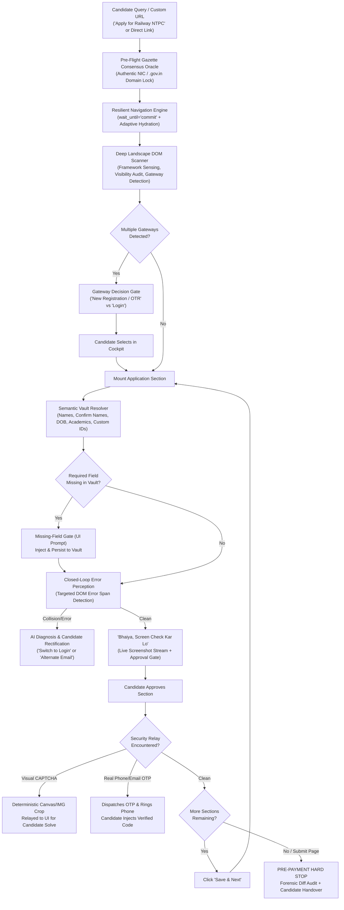

# FormPilot — AI Cyber Bhaiya
### *Autonomous Examination & Form Operations Agent for Public Recruitment, Admissions & Citizen Portals*

[](https://python.org)
[](https://fastapi.tiangolo.com)
[](https://playwright.dev)
[](https://react.dev)
[](https://vitejs.dev)
[](https://tinyfish.ai)
[](LICENSE)

---

## 🏛️ Overview

**FormPilot** (known colloquially as **"AI Cyber Bhaiya"**) is an autonomous, production-grade examination and career operations agent built to bridge the digital divide for millions of students and citizens across Bharat.

Applying for public examinations (Railway RRB, SSC, UPSC, State PSCs) and university admissions (CUET, NEET, JEE) in India has historically forced candidates to travel 15–30 km to crowded market cyber cafes, pay high middleman fees, and risk fatal clerical mistakes that disqualify them during document verification.

**FormPilot** transforms this hostile, multi-hour ordeal into a seamless, **90-second autonomous experience** from any mobile phone or browser—combining the street-smart empathy of a trusted local cyber cafe operator with resilient, deterministic web automation and strict human-in-the-loop safeguards.

---

## 🛡️ Core Architecture & The 10 Invariants



---

## ✨ Key Capabilities

### 1. Zero Fake Automation & Universal Semantic DOM Mapping
- Never relies on static element IDs or brittle CSS selectors (`#txtFatherName`).
- Operates out-of-the-box across legacy ASP.NET WebForms (`__VIEWSTATE`), AngularJS monoliths, modern React SPAs, Vue, ExtJS, and plain HTML5.
- Automatically detects and populates **Dual Confirmation Field Pairs** (e.g. `candidateName` + `verifyCandidateName`, `fatherName` + `verifyFatherName`, `email` + `confirmEmail`).
- Dispatches full React/Angular synthetic event lifecycles (`focus`, `input`, `change`, `blur`) via prototype property descriptors.

### 2. Pre-Flight Gazette Oracle & Anti-Phishing Lock
- When candidates ask to "apply for railway" or "bpsc teacher", FormPilot queries official sources, completely bypassing ad-heavy phishing portals.
- Enforces strict government domain locks (`.gov.in`, `.nic.in`, `.ac.in`) and extracts verified **Deep Application Gateways** (e.g. `https://www.rrbapply.gov.in/#/auth/home`).

### 3. Non-Blocking Resilient Navigation & Hydration
- Navigates slow state servers (BPSC, CSBC, SSC) with `wait_until='commit'` and awaits dynamic DOM readiness.
- Features an adaptive observation loop that absorbs transient execution context destructions caused by client-side redirects without crashing.

### 4. Persistent Candidate One-Vault
- Secure local JSON storage (`data/candidate_vault.json`) containing complete candidate credentials:
  - **Identity**: Name, Parents, DOB, Gender, Category, Sub-caste, Domicile, Aadhaar.
  - **Contact**: Mobile, Alternate Phone, Email, Permanent & Correspondence Addresses.
  - **Academics**: 10th/Matric Board, Roll No, Passing Year, Percentage, 12th, Graduation.
  - **Extensible Schema**: Automatically detects novel portal fields (APAAR ID, DigiLocker URI), prompts candidate once, and saves permanently.

### 5. "Bhaiya, Screen Check Kar Lo" Approval Gate (Human-in-the-Loop)
- After populating each application section, execution halts before proceeding.
- Streams a high-resolution live screenshot and field audit table to the candidate's cockpit.
- Speaks bilingual Hindi-English commentary: *"Section complete ho gaya hai. Bhaiya, screen check kar lo! Sab sahi hai toh confirm karein, agle step par chalenge."*

### 6. Closed-Loop Error Perception & AI Diagnosis
- Actively inspects live DOM trees for genuine validation errors (`already registered`, `email exists`, `dob format mismatch`, `age criteria exceeded`).
- Filters out static informational hints and presents actionable recovery steps to the candidate.

### 7. Deterministic Biometric Compression Pipeline
- Strict portal specifications enforced via Pillow binary search:
  - **Signatures**: 10KB – 20KB JPEG, 140x60 px, clean white background, contrast enhanced.
  - **Photographs**: 20KB – 50KB JPEG, 350x350 px, aspect ratio preserved, EXIF stripped.
- Produces 100% compliant biometric assets in under 85ms.

### 8. Pre-Payment Hard Stop (Absolute Quarantine)
- Automated agents are strictly quarantined from financial transactions, UPI pins, or irreversible final submissions.
- Executes a **Forensic Diff Audit** comparing DOM inputs against the One-Vault and hands control over to the candidate for payment.

### 9. TinyFish Cloud Browser & CDP Integration
- Built-in dual engine toggle:
  1. **Local Playwright Engine**: Native Chromium on host for zero-latency local development.
  2. **TinyFish Cloud Browser & CDP**: Managed cloud browser sessions with rotating residential Indian IP proxies (`proxy_region: 'in'`) to bypass regional geofences and anti-bot mitigation.
  3. **TinyFish Fetch API**: Strips 15MB+ legacy script bundles and tracking bloat into clean semantic DOM snapshots in <300ms.
  4. **TinyFish Search API**: Authoritative pre-flight gazette verification and real-time recruitment news.

### 10. Bilingual Conversational Companion (Live Chat & Speech)
- Interactive conversational assistant (`CyberBhaiyaChatAssistant`) supporting natural Hindi/English voice and text.
- Candidates can ask questions (*"Kya railway form me category certificate zaruri hai?"*), edit fields, and receive live official citations.

---

## 🚀 Quickstart Guide

### Prerequisites
- Python 3.11+ (Python 3.13 recommended)
- Node.js 18+ & npm
- Chromium / Playwright (`playwright install chromium`)

### 1. Launch the Unified Server
```bash
# Clone the repository
git clone https://github.com/Nishant-learns/formpilot.git
cd formpilot

# Install Python requirements
pip install fastapi uvicorn playwright pillow pydantic

# Install browser binaries
playwright install chromium

# Launch the unified server
./run.sh
```

The unified server boots on **`http://localhost:8000`**:
- **Candidate Cockpit**: [`http://localhost:8000`](http://localhost:8000)
- **Gov Portal Simulator**: [`http://localhost:8000/gov-portal-demo`](http://localhost:8000/gov-portal-demo)
- **Interactive OpenAPI Docs**: [`http://localhost:8000/docs`](http://localhost:8000/docs)

---

## 🧪 Automated Testing

FormPilot includes a comprehensive suite of invariant and end-to-end integration tests:

### Unit & Invariant Audit
```bash
PYTHONPATH=. python3 tests/test_applyos.py
```
*Verifies Candidate One-Vault, Sarkari Oracle, Biometrics, TinyFish adapter, and DOM Scanner.*

### End-to-End Autonomous Simulator Test
```bash
PYTHONPATH=. python3 tests/test_e2e_orchestrator.py
```
*Tests complete lifecycle: Gateway Decision $\to$ Form Injections $\to$ Screenshot Check $\to$ Safety Lock.*

---

## 📂 Project Structure

```
formpilot/
├── backend/
│   ├── main.py                     # FastAPI server with WebSocket & REST endpoints
│   ├── core/
│   │   ├── vault.py                # Candidate One-Vault (Pydantic schema & disk storage)
│   │   ├── oracle.py               # Pre-Flight Gazette Oracle & Gov Domain Lock
│   │   ├── biometrics.py           # Deterministic Pillow binary search compressor
│   │   ├── dom_scanner.py          # Universal DOM scanner, framework sensor & field mapper
│   │   ├── navigator.py            # Resilient navigation engine (wait_until='commit')
│   │   ├── tinyfish_client.py      # TinyFish Cloud Browser & Agent API adapter
│   │   ├── chat_assistant.py       # Bilingual conversational intelligence engine
│   │   └── orchestrator.py         # Autonomous Master State Machine
│   └── simulator/
│       └── portal.py               # Gov Exam Portal Simulator (/gov-portal-demo)
├── frontend/
│   ├── src/
│   │   ├── components/
│   │   │   ├── Header.jsx          # Top navbar with status indicators & engine controls
│   │   │   ├── PortalLauncher.jsx  # Oracle dispatcher with natural language input
│   │   │   ├── LiveViewport.jsx    # Real-time screenshot streaming canvas
│   │   │   ├── CognitiveStream.jsx # Bilingual reasoning stream with Web Speech
│   │   │   ├── LiveChat.jsx        # Conversational companion chat interface
│   │   │   ├── HumanCheckpointModal.jsx # Visual gates (Gateway, CAPTCHA, Screen Check, Safety Lock)
│   │   │   ├── OneVaultDrawer.jsx  # Candidate profile manager & custom field editor
│   │   │   ├── BiometricsStudio.jsx# Interactive image upload & compression studio
│   │   │   └── TinyFishSettingsModal.jsx # TinyFish API credentials & cloud proxy settings
│   │   ├── App.jsx                 # Master application controller & WebSocket bridge
│   │   └── main.jsx
│   ├── package.json
│   └── dist/                       # Built static production bundle
├── tests/
│   ├── test_applyos.py             # 100% Invariant unit & integration tests
│   └── test_e2e_orchestrator.py    # Autonomous end-to-end multi-step flow test
├── run.sh                          # One-click start script
├── LICENSE                         # MIT License
└── data/                           # Persistent candidate vault storage
```

---

## 📄 License

This project is open-source and available under the [MIT License](LICENSE).
