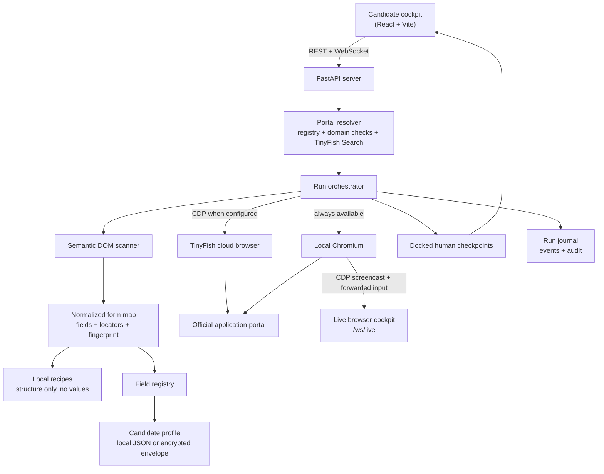

# FormPilot

**A guided application assistant for public recruitment and admission forms.**

FormPilot helps a candidate fill long official forms from one saved profile, review every section before continuing, and stop safely before payment or final submission. It is an independent project: it is **not** a government website and it never submits an application or makes a payment on the candidate's behalf.

[](https://python.org)
[](https://fastapi.tiangolo.com)
[](https://react.dev)
[](https://playwright.dev)
[](https://tinyfish.ai)
[](LICENSE)

---

## Why FormPilot

Public application forms are repetitive and unforgiving. A single mismatched name, an expired category certificate, or an incorrectly sized photograph can invalidate an application after hours of work.

FormPilot reduces that risk with a simple loop:

1. **Find the official portal.** A curated registry resolves common recruitment bodies; unknown requests can be checked with TinyFish Search. Non-government links are flagged before they are opened.
2. **Fill from a saved profile.** A single candidate profile supplies identity, contact, address, academic, and custom fields. Confirmation fields such as “Verify Name” and “Confirm Email” stay in sync.
3. **Review each section in a real browser.** The run pauses after every section. The candidate sees the actual interactive page, a live field-level audit, and a docked checkpoint. They can approve, type directly into the page, or stop.
4. **Stop before payment or submission.** FormPilot never clicks a payment or final-submit button. The final screen is a handover with the filled details and the official portal still open.

The included practice portal lets judges and new contributors try the complete flow safely, including CAPTCHA, OTP, and file-upload checkpoints, without touching a real government site. A separate **inspect-only** mode opens a real portal, maps its fields and selectors, and stops without filling or submitting anything.

---

## What is included

| Area | Capability |
|---|---|
| **Portal resolution** | Registry of official recruitment and admission portals, direct-URL domain checks, and optional live search through TinyFish |
| **Guided filling** | Semantic DOM scanner, dual confirmation fields, custom portal fields, missing-field prompts, error detection |
| **Live browser** | The real Chromium page streamed over CDP, with mouse, wheel, keyboard, paste, navigation, and resize forwarded from the cockpit |
| **Inspect-only mode** | Opens a real portal, builds a normalized form map, and stops. Nothing is filled, clicked, paid, or submitted by the agent |
| **Form memory** | Per-step recipes store page structure, locators, and fingerprints (never values), with versioning and drift detection when a portal changes |
| **Human checkpoints** | Gateway choice, unknown/missing field, CAPTCHA handoff, OTP, live photo, file upload, section approval, and a pre-payment / final-submission safety stop |
| **Candidate profile** | One reusable profile with nested academic records, custom fields, and masked sensitive values |
| **Document preparation** | Deterministic photo and signature compression to common portal ranges (20–50 KB / 350×350 px and 10–20 KB / 140×60 px) |
| **Assistant** | Candidate-facing chat for common questions, saved-detail corrections, status, pause/resume, and live web results |
| **Run journal** | Local JSONL events, run metadata, and the final audit for support and review |
| **Deployment controls** | Optional API token, protected uploads, redacted configuration, optional AES-256-GCM profile encryption |
| **Practice portal** | A clearly labelled demo site with new-registration and returning-candidate routes |

---

## Architecture



The orchestrator is portal-agnostic. A small adapter supplies hints for the practice portal (current step, payment screen, next button), while the DOM scanner and field registry handle ordinary HTML forms.

### Live browser and inspect-only mode

There are two ways to start a session:

- **Fill** — the agent fills from the saved profile, pauses at human-only steps, and stops before payment or final submission.
- **Inspect** — the agent opens the same real page, maps its fields and selectors, and stops. The page stays interactive, but the agent never fills, clicks, pays, or submits. This is the safe way to try a real public portal before trusting it with a run.

The cockpit is not a screenshot viewer. It connects to the Chromium page over CDP, receives frames, and forwards mouse, wheel, keyboard, paste, navigation, and resize events. During a checkpoint the live page remains usable while the panel is docked on the right, so the candidate can scroll, correct a field, solve a challenge, or attach a file without losing the agent's audit.

Each observation is reduced to a normalized **form map**: page type and confidence, field semantics, multiple locator strategies, file/CAPTCHA/OTP signals, next actions, and a structural fingerprint. Fingerprints ignore values, CSRF tokens, and random ids. Local **recipes** store only structure and locators; they never contain field values or personal data. A multi-step form is remembered per visible step (heading, active section, form action, and field structure), so saving step 2 cannot overwrite step 1. A renamed heading is matched by structure and saved as a new version of the same step. When a portal changes, the recipe reports drift and the live page wins, so the agent re-observes instead of trusting a stale selector.

### Human checkpoints

FormPilot pauses at the following points:

- **Gateway choice** — new registration or returning candidate.
- **Missing field** — a detail is required but not saved; the candidate enters it once.
- **Unknown field** — no high-confidence match exists. FormPilot asks instead of guessing. The value is stored as a local custom field, not in a shared recipe.
- **CAPTCHA / interactive challenge** — the live browser is handed to the candidate. FormPilot detects text, slider, drag, and interactive widgets, but has no solver, token injection, or bypass. The candidate solves it in the real page and confirms.
- **OTP** — the candidate enters the code in the panel or directly in the live page. It is not stored in the profile.
- **Live photo / file upload** — the candidate uses their own camera or chooses a file. The file is attached to this browser session only, not saved to the vault, and FormPilot verifies that the input actually has a file before continuing.
- **Section approval** — the candidate reviews the audit and the live form before advancing. Choosing “I need to edit something” keeps the checkpoint open so later agent steps do not overwrite those edits.
- **Pre-payment safety stop** — FormPilot stops and hands control back. It does not click payment or final-submit buttons.

---

## TinyFish integration

FormPilot uses TinyFish as an optional web-data and browser layer. A key is **not** required for the local practice flow; without one, FormPilot uses the built-in registry and local Chromium and says so in the activity log.

| Purpose | Request |
|---|---|
| **Search** — find an official notification or portal | `GET https://api.search.tinyfish.ai?query=...&location=IN` |
| **Fetch** — read a page as clean content | `POST https://api.fetch.tinyfish.ai` with `{"urls": ["..."], "format": "markdown"}` |
| **Cloud browser** — obtain a CDP session | `POST https://api.browser.tinyfish.ai` with `{"url": "...", "proxy_config": {"country_code": "IN"}}` |
| **Session cleanup** | `DELETE https://api.browser.tinyfish.ai/{session_id}` |
| **Wallet** (read-only) | `GET https://agent.tinyfish.ai/v1/wallet` |

All requests send the key in the `X-API-Key` header. The key is read from `TINYFISH_API_KEY` or the in-app connection settings. It is never returned by the API: configuration responses show `***` and a boolean “configured” flag.

### Cloud browser or local browser?

- **Local mode** always uses Playwright's Chromium on the same machine. This is the default for the practice portal and for `127.0.0.1` / `localhost` targets.
- **Auto mode** uses the TinyFish cloud browser for public `https://` targets when a key is configured, otherwise it falls back to local Chromium.
- **Cloud mode** requests a TinyFish browser session for public targets. If the session cannot be created, the run continues locally and the activity log labels the fallback. The app never presents a local browser as a cloud session.

Cloud browser sessions are metered by TinyFish. Use them deliberately, and check the wallet endpoint in **Settings → TinyFish connection** before a long run.

### Checking status and limits

Two endpoints answer “is TinyFish working, and do I have budget?”:

```bash
# Free Search call: verifies the key and connectivity without spending the wallet
curl -s -X POST http://127.0.0.1:8000/api/engine/test-tinyfish \
  -H 'Content-Type: application/json' -d '{}'

# Wallet balance
curl -s http://127.0.0.1:8000/api/engine/wallet
```

`test-tinyfish` returns `status: authenticated` when the key and Search API are working. On failure it returns the exact TinyFish code instead of a generic error:

| `status` | Meaning |
|---|---|
| `missing_key` / `INVALID_API_KEY` | No key, or the key was revoked. |
| `INSUFFICIENT_CREDITS` | Wallet balance is zero or negative (HTTP 402). Not retryable until you top up; minimum $10. |
| `FREE_ALLOWANCE_EXHAUSTED` | The product's daily free allowance is used; wait for the 00:00 UTC reset. |
| `RATE_LIMIT_EXCEEDED` | Per-minute limit hit (HTTP 429). `retry_after`, `rate_limit.limit`, `rate_limit.remaining` and `rate_limit.reset` are returned. |
| `FORBIDDEN` | Legacy credits exhausted, missing entitlement, or an organization spending limit. |
| `network_error` / `BACKEND_UNAVAILABLE` | TinyFish could not be reached; retry with backoff. |

Search and Fetch are free within daily allowances (12,000 searches and 1,000 fetched URLs, reset at 00:00 UTC) and have per-minute limits (30 searches/min, 150 fetches/min). The cloud browser is metered at $0.002/minute; the Agent API at $0.016/step. FormPilot uses Search, Fetch, Browser and Wallet — not the Agent automation API.

If a cloud browser session cannot start, the run continues locally. `GET /api/agent/state` exposes `engine_session.is_cloud`, `engine_session.proxy_node` and `engine_session.fallback_reason`, so you can tell a real cloud session from a local fallback and read the TinyFish error code behind it. The activity log also names the code.

---

## Quickstart

### Requirements

- Python 3.11 or newer
- Node.js 20 or newer
- A Chromium browser for Playwright

### Recommended setup

```bash
git clone https://github.com/Nishant-learns/formpilot.git
cd formpilot

./scripts/bootstrap.sh
```

The bootstrap script creates `.venv`, installs backend and frontend dependencies, downloads Chromium, copies `.env.example` to `.env` if needed, and builds the frontend.

Start the app:

```bash
./run.sh
```

Open **http://127.0.0.1:8000**. The practice portal is at **http://127.0.0.1:8000/gov-portal-demo**.

### Manual setup

```bash
python3 -m venv .venv
. .venv/bin/activate
pip install -r requirements-dev.txt
python -m playwright install chromium

cp .env.example .env
# Optional: add TINYFISH_API_KEY to .env for live search and cloud browser sessions.

npm ci --prefix frontend
npm run build --prefix frontend
./run.sh
```

`run.sh` loads `.env` when present, prefers `.venv`, and binds to `127.0.0.1:8000` by default. Use `FORMPILOT_HOST` and `FORMPILOT_PORT` to change that.

---

## Practice demo

The practice portal is a **fictional demo**, not a government website. It uses dummy details only and never contacts a real portal.

| Item | Value |
|---|---|
| New registration | Open `/gov-portal-demo`, choose **New registration** |
| Returning candidate | Registration `FP-2026-881902`, password `Practice@123` |
| Demo CAPTCHA | `7X9KP` (registration form), `4X9K` (login) |
| Demo OTP | `492015` |
| Demo profile | `Aman Kumar Sharma` / `demo.candidate@example.com` |

The values are shown in the practice UI so the flow can be tested without external services. They are not real credentials.

Reset the local demo after experimenting:

```bash
python scripts/reset_demo.py
```

This restores the fictional profile, removes practice registrations, clears run journals, and deletes generated photo/signature files. It does not touch `.env` or source code.

### What the demo exercises

- Portal lookup and domain verification
- Gateway choice between new registration and login
- Field filling from the saved profile
- Missing-field, OTP, and text-CAPTCHA checkpoints
- Interactive live-browser takeover at checkpoints
- Live photo and file-upload handoff with verified attachment
- Section approval with the live page and a field-level audit
- Pre-payment handover with a field-by-field match count

The full flow can also be driven from a terminal after the server is running:

```bash
python scripts/e2e_demo.py                    # new registration
python scripts/e2e_demo.py --login            # returning candidate
python scripts/e2e_demo.py http://127.0.0.1:8000/gov-portal-demo
```

The E2E driver answers the demo checkpoints, attaches sample files only to the practice portal, and asserts that the run stops before payment.

### Trying a real portal safely

Use the **Inspect** toggle in the launcher before opening a real portal:

1. Paste the official URL, or pick a verified portal from the registry.
2. Choose **Inspect** and open it.
3. Scroll and click the real page yourself to reach the form you care about.
4. Press **Rescan** to see the normalized fields, locators, CAPTCHA/OTP signals, and recipe status in the **Page map** tab.

Inspect mode does not type, click, upload, pay, or submit on your behalf. It is deliberately read-only from the agent's side. When you are ready for a guided run, switch back to **Fill**; the run will still pause at every human-only step and stop before payment or final submission.

---

## Configuration

Copy `.env.example` to `.env` and adjust as needed. Important variables:

| Variable | Default | Purpose |
|---|---|---|
| `FORMPILOT_ENV` | `demo` | `demo` or `production` |
| `FORMPILOT_DEMO_MODE` | `true` in demo | Enables demo conveniences |
| `FORMPILOT_ENABLE_SIMULATOR` | `true` in demo | Serves the practice portal |
| `FORMPILOT_HOST` / `FORMPILOT_PORT` | `127.0.0.1` / `8000` | Bind address for `run.sh` |
| `TINYFISH_API_KEY` | empty | Enables live search, fetch, and cloud browser sessions |
| `TINYFISH_MODE` | `auto` | `auto`, `local`, or `cloud` |
| `TINYFISH_PROXY_COUNTRY` | `IN` | Two-letter region for cloud browser sessions |
| `TINYFISH_TIMEOUT_SECONDS` | `90` | Cloud browser session timeout |
| `FORMPILOT_AUTH_TOKEN` | empty | Require a shared token for API, WebSocket, and uploads |
| `FORMPILOT_VAULT_KEY` | empty | Base64 32-byte key for AES-256-GCM profile encryption |
| `FORMPILOT_MASK_PII` | `false` | Mask sensitive values in API responses |
| `FORMPILOT_NTFY_TOPIC` | `formpilot_demo_otp` | ntfy topic used by the OTP relay |
| `FORMPILOT_DEMO_OTP` | `492015` | Fallback code for the practice flow |
| `FORMPILOT_LLM_API_KEY` | empty | Enables the model-driven chat assistant |
| `FORMPILOT_LLM_BASE_URL` | `https://api.openai.com/v1` | Any OpenAI-compatible endpoint |
| `FORMPILOT_LLM_MODEL` | `gpt-4o-mini` | Model used for chat replies and actions |
| `FORMPILOT_LLM_TIMEOUT_SECONDS` | `45` | Per-call model timeout |

The chat assistant is model-driven: it reads the live page state and acts
through tools. Without a key it falls back to a clearly labelled deterministic
helper. Any OpenAI-compatible endpoint works, including Gemini's OpenAI shim
(`https://generativelanguage.googleapis.com/v1beta/openai`) and a local Ollama
server (`http://127.0.0.1:11434/v1`, no key). The same values can be saved from
**Settings → AI assistant**; that file (`data/llm_config.json`) is gitignored.

Generate a profile-encryption key:

```bash
python scripts/generate_vault_key.py
```

Changing or losing `FORMPILOT_VAULT_KEY` makes an encrypted profile unreadable. Back up the key separately from the profile file.

---

## API overview

The cockpit uses these endpoints; the full schema is available at **http://127.0.0.1:8000/docs**.

| Method | Path | Purpose |
|---|---|---|
| `GET` | `/api/health` | Health, demo status, TinyFish configuration status |
| `GET` / `POST` | `/api/engine/config` | Read redacted TinyFish settings, or save them |
| `POST` | `/api/engine/test-tinyfish` | Test the key and Search API; returns the exact TinyFish error code |
| `GET` | `/api/engine/wallet` | Read-only TinyFish wallet balance |
| `GET` | `/api/oracle/search?q=...&live=false` | Resolve a portal from the registry or a direct URL |
| `GET` | `/api/oracle/directory` | List the verified portal registry |
| `GET` / `POST` | `/api/vault` | Read or update the candidate profile |
| `POST` | `/api/vault/custom-field` | Add a portal-specific field |
| `POST` | `/api/vault/reset` | Restore the demo profile (demo mode only) |
| `POST` | `/api/biometrics/compress-photo` | Compress a photograph |
| `POST` | `/api/biometrics/compress-signature` | Compress a signature |
| `POST` | `/api/agent/start` | Start a guided run in `fill` or `inspect` mode |
| `GET` | `/api/agent/state` | Current state, live session, form map, recipe, and active checkpoint |
| `POST` | `/api/agent/inspect/scan` | Re-read the current page in inspect mode |
| `POST` | `/api/agent/upload` | Attach a validated image or PDF to the live form |
| `POST` | `/api/agent/user-response` | Answer an open checkpoint |
| `POST` | `/api/agent/dismiss-gate` | Close a checkpoint without answering it |
| `POST` | `/api/agent/stop` | Stop the run and close the browser |
| `GET` | `/api/recipes` | List local recipes (structure only, no values) |
| `GET` | `/api/recipes/{recipe_id}` | Read one recipe |
| `POST` | `/api/chat/message` | Ask FormPilot a question |
| `GET` | `/api/runs` | List local run journals |
| `WS` | `/ws/cockpit` | Live events, state, and chat |
| `WS` | `/ws/live?session_id=...&access_token=...` | Interactive frames and input for the live browser |

When `FORMPILOT_AUTH_TOKEN` is set, every `/api/*` route except health and the practice portal, plus `/uploads/*`, requires the token as `X-API-Token`, `Authorization: Bearer ...`, or the `token` query parameter for WebSocket connections.

---

## Testing

Install the development dependencies and run the backend suite:

```bash
pip install -r requirements-dev.txt
pytest
```

The default suite covers the field registry, profile persistence and encryption, portal resolution, TinyFish request handling, assistant behaviour, biometrics, API security, run journals, the normalized form map, recipe drift, live-browser transport and control gating, real-DOM CAPTCHA/OTP/file detection, and upload routing. Chromium-dependent tests skip when the browser cannot be launched.

The browser-based end-to-end test is opt-in:

```bash
# Start the app in one terminal
./run.sh

# In another terminal
FORMPILOT_E2E_URL=http://127.0.0.1:8000/gov-portal-demo pytest -m e2e
```

To smoke-test inspect mode against a real portal, start the server and use **Inspect** in the launcher, or call the API directly:

```bash
curl -X POST http://127.0.0.1:8000/api/agent/start \
  -H 'Content-Type: application/json' \
  -d '{"query_or_url": "https://www.rrbapply.gov.in/#/auth/home", "mode": "inspect"}'

curl http://127.0.0.1:8000/api/agent/state
```

The state response includes the live session, normalized form map, and recipe status. In inspect mode nothing is submitted.

Run the quick API smoke test:

```bash
python scripts/smoke_test.py
```

Build the frontend:

```bash
npm ci --prefix frontend
npm run build --prefix frontend
```

CI runs the backend tests and the frontend production build on every push and pull request.

---

## Security and privacy

FormPilot is designed for local-first use with a clear demo/production boundary.

- **No secrets in the repository.** API keys are read from the environment or entered in the settings dialog. Configuration responses redact the key and never include a preview.
- **Runtime data is ignored.** The profile, engine configuration, practice registrations, local recipes, run journals, uploads, and `.env` files are excluded from git. Only example files are tracked.
- **Sensitive values are masked.** API views can mask Aadhaar numbers, passwords, and phone numbers. The audit and support exports use the same masking rules.
- **The profile can be encrypted at rest.** Set `FORMPILOT_VAULT_KEY` to store an AES-256-GCM envelope instead of plaintext JSON.
- **Uploads are constrained.** Image and PDF type, size, and file names are validated. A selected file is attached to the current browser session and is not written into the saved profile.
- **Live controls are scoped.** Each live session has its own access token and WebSocket path. Mouse, key, paste, and navigation input is refused while the agent is driving; the checkpoint explicitly grants control for the human-only step.
- **Recipes contain no values.** A recipe stores labels, types, options, locators, and a structural fingerprint. Field values, uploaded files, and personal data are never written to it.
- **Unknown values are not guessed.** FormPilot asks when no high-confidence field match exists. CAPTCHA and OTP answers are treated as one-time human input, not profile fields.
- **Challenges stay human.** There is no CAPTCHA solver, token injection, or challenge bypass. The live browser is handed to the candidate, and the agent resumes only after they confirm.
- **The API can be gated.** Set a long random `FORMPILOT_AUTH_TOKEN` before exposing the app beyond localhost.
- **The demo is fictional.** The default profile uses reserved example domains and clearly fictional identifiers. It is not a real candidate's data.
- **No payments and no automatic submission.** The run stops at the payment or final-submission screen. The candidate completes payment and final submission directly on the official portal.

For a shared deployment, also use HTTPS behind a reverse proxy, a private ntfy topic, a strong auth token, encrypted storage, and a production process manager. Disable the practice portal with `FORMPILOT_ENABLE_SIMULATOR=false` outside demos.

---

## Project structure

```text
formpilot/
├── backend/
│   ├── main.py                 # FastAPI app, auth, REST/WebSocket, static frontend
│   ├── core/
│   │   ├── orchestrator.py     # Guided run loop, inspect mode, and human checkpoints
│   │   ├── live_browser.py     # CDP screencast, input forwarding, session registry
│   │   ├── form_model.py       # Page classification, locators, form fingerprints
│   │   ├── recipe.py           # Local structure recipes and drift detection
│   │   ├── dom_scanner.py      # Semantic field detection and safe DOM updates
│   │   ├── field_registry.py   # Canonical field keys and vault resolution
│   │   ├── vault.py            # Candidate profile and persistence
│   │   ├── vault_crypto.py     # Optional AES-256-GCM envelope
│   │   ├── oracle.py           # Portal registry and domain checks
│   │   ├── tinyfish_client.py  # Search, Fetch, Browser, and Wallet clients
│   │   ├── chat_assistant.py   # Candidate-facing assistant
│   │   ├── biometrics.py       # Photo and signature compression
│   │   ├── navigator.py        # Resilient navigation helpers
│   │   ├── portal_adapter.py   # Portal-specific step and button hints
│   │   ├── run_store.py        # Local event and audit journal
│   │   ├── otp_service.py      # OTP relay
│   │   └── settings.py         # Environment-backed configuration
│   └── simulator/portal.py     # Practice portal and demo endpoints
├── frontend/
│   ├── src/                    # React cockpit
│   └── dist/                   # Built assets served by FastAPI
├── data/                       # Runtime data (ignored; examples tracked)
├── scripts/                    # Bootstrap, reset, smoke test, E2E driver
├── tests/                      # Backend test suite
├── .env.example
├── requirements.txt
├── requirements-dev.txt
└── run.sh
```

---

## Limitations

- FormPilot depends on the structure of the page it is filling. A major portal redesign can produce recipe drift and require a re-scan or an update to the DOM classifier or portal adapter.
- CAPTCHA, OTP, live photo, payment, and final submission always require the candidate. FormPilot does not solve challenges or complete those steps automatically.
- The live view is a CDP screencast with forwarded input, not a WebRTC desktop. It is responsive on a local machine; a remote deployment adds latency. A Neko/WebRTC transport is a future upgrade and needs Docker or equivalent infrastructure.
- A cloud browser cannot access the candidate's local camera. Live-photo steps use a local camera capture or file selection in the checkpoint, or the candidate completes the portal's own webcam step directly.
- Cross-origin iframes and closed shadow roots can hide fields from the scanner. Inspect mode shows what was found before a run.
- The portal registry is intentionally small and auditable. Unknown portals are verified from a direct URL or left unverified.
- TinyFish Search results are evidence, not confirmation. Always check the official notification and eligibility rules.
- Cloud browser sessions are metered and depend on TinyFish availability; local Chromium remains the fallback.
- The practice portal is for demonstration and testing only. It must not be presented as a real government service.

---

## Contributing

Issues and pull requests are welcome. Before opening a pull request:

```bash
pytest
npm run build --prefix frontend
```

Please keep test data fictional, never commit a real API key or candidate's personal data, and add a test for any change to the field registry, portal resolution, or checkpoint behaviour.

## License

MIT. See [LICENSE](LICENSE).
